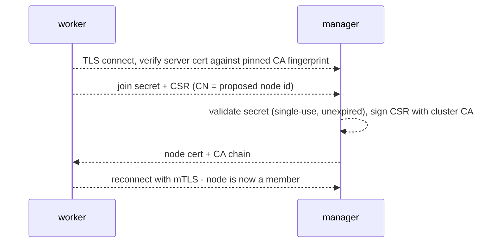
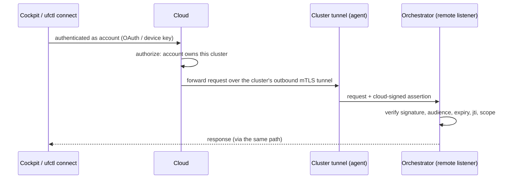

# RFD 5: Cluster Membership & Access Control

Status: proposed. Nothing here is implemented except the stopgaps listed under [Migration](#migration).

This RFD answers two questions the Orchestrator has so far dodged: **how does a second machine join a cluster**, and **who is allowed to drive the Orchestrator, from where**. It follows the security pass that put every edge listener on loopback by default (see the *Security model* section of [edge/orchestrator/README.md](../edge/orchestrator/README.md)).

## Decisions

These were settled in design discussion and are the premises of everything below.

1. **The local Orchestrator UI/API is never published.** Remote and team access is the job of the **Cockpit UI** (cloud). The Orchestrator therefore needs no internet-grade login: no password database, no signup, no rate-limited login endpoint, no MFA.
2. **A registered cluster stays fully operable with the cloud down.** Every local path (CLI, loopback UI/API, agent link) works offline. Only Cockpit and `ufctl connect` need the cloud.
3. **`ufctl connect` is an escape hatch, not a product.** A tier-3 support path for one operator, on their own machine. It must not grow into a second Cockpit.
4. **MVP authorization is "owner + scoped tokens".** Teams and roles come from cloud accounts (Cockpit), not from the edge.
5. **Agents dial out.** A worker exposes no listening ports. The Orchestrator never initiates a connection to an agent.
6. **The agent link is a gRPC bidirectional stream.** It is the control plane. yamux multiplexing stays what it is today: the transport for gateway port streaming.
7. **Cloud assertion keys are fetched and cached** (JWKS-style), not pinned at registration.

## Principals

Each kind of caller gets the credential its channel already provides. We do not invent a user table.

| Principal | Reaches the Orchestrator via | Credential |
| --- | --- | --- |
| Operator at the machine | `orcli`/`ufctl` over the unix socket | The OS user (socket is `0600`, CLI checks the owner) |
| Same-host UI | Loopback REST | Host + Origin guards (no login; see [Local trust](#local-trust-and-its-limits)) |
| Agent (any node) | Orchestrator cluster listener | Per-node mTLS cert from the **cluster CA** |
| Cockpit / `ufctl connect` | The cluster's outbound cloud tunnel | Cloud-signed **assertion** (see [Remote access](#remote-access)) |
| Automation | Loopback REST or CLI | Scoped API token, minted over the socket, hashed at rest |

## Cluster membership

### Cluster CA

On first start the Orchestrator generates a **cluster-local CA** (key never leaves the manager). It is unrelated to the cloud CA: local trust must not depend on the cloud, and ROADMAP already notes the cloud's CA and JWT key being the same key is a shortcut to retire, not copy.

### Two listeners

| Listener | Binds | Auth | Exists |
| --- | --- | --- | --- |
| Local | `127.0.0.1:50100` | None (trusted host; see below) | Always |
| Cluster | Advertised address | **mTLS required**, client cert must chain to the cluster CA | Only after `orcli nodes add` |

A non-loopback listener cannot exist without mTLS, so no "insecure remote" flag is needed. This replaces `UNDERLEAF_CLUSTER_TOKEN` and `UNDERLEAF_INSECURE_ALLOW_REMOTE`, which are stopgaps.

### Join flow

```
manager$ orcli nodes add                       # first run also enables the cluster listener
  curl -fsSL https://…/install.sh | sh -s -- join ulj_Zk3…     (single use, 15 min)

worker$  <paste>                               # installs ufagentd, joins, done
```

The join string is one opaque value: manager address + **cluster CA fingerprint** + single-use secret (same idea as kubeadm's discovery hash). The fingerprint lets the worker authenticate the manager *before* sending anything, so the secret is never exposed to a MITM.



Secrets are stored hashed, consumed on first use, and expire. A node is removed with `orcli nodes rm`, which revokes its cert (the manager keeps a deny list keyed by serial, pruned as entries pass their expiry; see [Certificate lifetimes](#certificate-lifetimes)).

An approval variant (worker shows a code, operator approves it in the CLI/UI, mirroring `orcli cloud register`) is a possible follow-up for interactive installs. The token form is the default because it works for headless provisioning.

### Certificate lifetimes

Biased toward long lifetimes. A failed rotation takes a node offline, while a long-lived cert costs almost nothing in a cluster this small.

- **Cluster CA: 10 years.** Rotating a CA is the dangerous operation, so push it beyond the product's operating horizon. The trust bundle should still be able to hold more than one CA, so a rotation remains possible later.
- **Node certs: 730 days**, matching the cloud-issued cluster certs, so there is one lifetime to reason about. `NotBefore` is backdated a few minutes for clock skew.
- **Renewal starts 90 days before expiry**, over the live mTLS link, retried daily. A node gets ~90 attempts before a renewal can fail. (The cloud flow uses a 30-day window; this one is deliberately wider.)
- **Backstop: re-enroll.** Renewal authenticates with the existing cert, so an *expired* cert is a hard stop (the same constraint noted in `registration_service.go`). A node in that state, for example a spare machine powered off for two years, re-joins with a fresh `orcli nodes add` string and keeps its node id. A missed rotation is a one-line fix, not a rebuild.
- **Visible.** `orcli nodes ls` shows each node's expiry and warns at 30 days.
- **Revocation does not need short certs.** The deny list is keyed by serial and is tiny at cluster scale even with two-year certs.

### Agents dial out

Today the Orchestrator dials the agent (`agentAddr` in [agent_client.go](../shared/clients/agent_client.go), `singleNode()` in the reconciler). That makes `:50101` — effectively remote Docker execution — a listening port on every worker. Instead:

- The agent opens one long-lived outbound connection, the **agent link**, to the cluster listener and authenticates with its node cert. (Not to be confused with gateway *streams*, which carry published ports to the public.)
- The Orchestrator sends commands (create/start/remove container, list volumes, …) *down the link* and gets responses back. The link is a **gRPC bidirectional stream**: the agent calls one long-lived RPC on the cluster listener, commands flow down it and results flow up, matched by request ID. The existing `AgentPublic` methods are re-expressed as that command/response vocabulary (the main cost of this choice). The link carries control only; port streaming keeps using yamux.
- Workers listen on nothing. The agent's own unix-socket CLI is unchanged.

The agent already dials out toward the cloud (`conn_client`), so outbound-only is an established pattern; what is new is a control RPC on top of it. The reconciler picks a target node by link rather than by address, which also removes the hardcoded single-node assumption.

### Single-node

The default install is a one-node cluster whose agent uses the **local listener** (no ceremony, nothing to paste). It is not forced through enrollment. If later we want one code path, `install.sh` can run the join flow against the local listener automatically; that is an optimization, not a requirement.

## Local trust and its limits

Loopback REST and the local gRPC listener are unauthenticated by design: anyone with a shell on the manager can already drive Docker, so a login adds nothing. That assumption has two holes that this RFD closes rather than papers over.

**Workloads share the control plane's network.** The agent creates workload containers with no network configuration ([docker_service.go](../edge/agent/service/docker_service.go)), so they land on Docker's default bridge, and `install.sh` starts the Orchestrator on that same bridge with all-interfaces binds inside the container. A compromised workload can therefore reach `:9090` and `:50100` directly. The Host-header guard is not a defence: the attacker sets the header.

Fix: the Orchestrator runs on its own user-defined Docker network, and workloads run on a different one. Separate user-defined networks are isolated from each other. The host agent still reaches the Orchestrator through the loopback-published port.

> **Caveat found while implementing step 1** (see the [journal](RFD-5-journal.md), step 1): Docker isolates *unpublished* ports between user-defined networks, but a *published* port (here `:50100`, and the UI/API port) stays reachable from a container on another network through the Orchestrator's container IP, and on Docker Desktop also through `host.docker.internal`. The loopback-published ports the host agent and browser need are exactly those, so this fix closes the unpublished ports and name resolution but not the published ones. Whether and how to close them is an open decision.

**Loopback is not a trust boundary when something on the host forwards to it.** The agent forwards gateway streams to local ports. Nothing today stops `orcli streams new --port 9090` from publishing the Orchestrator's REST API. The Host guard happens to block it (the gateway hostname is not loopback), but that is an accident of one check.

Fix, enforced in the agent where the stream is opened: **streams may not target control-plane ports** (Orchestrator REST/gRPC, agent sockets/ports). Reject at creation and on every forward.

## Remote access

Remote humans use **Cockpit**, and `ufctl connect` is its single-operator little sibling. They share one mechanism so the edge has exactly one remote-auth path to get right.



- **Assertion, not a header.** The cloud attaches a short-lived (≈60 s) signed assertion: subject (account/device), `aud` = this cluster id, scopes, `exp`, `jti`. The Orchestrator verifies it cryptographically against the cloud's assertion keys (see below). We do not trust network position: cloud_api's `X-Subject-Id` bypass (ROADMAP track 4) is the cautionary tale, and the tunnel multiplexes public gateway traffic with control traffic, so confusion between the two must fail closed.
- **Assertion keys are fetched and cached.** The cloud publishes its assertion public keys as a key set with key IDs (`kid`), JWKS-style. The Orchestrator fetches the set at registration and refreshes it periodically, persists it to disk, and verifies against the cached copy, so a cloud outage does not break verification of assertions that still arrive. Rules that keep this safe:
  - *Fail closed.* No key ever fetched means every assertion is rejected.
  - *Rotation overlap.* Keep old keys until their stated expiry so in-flight assertions survive a rotation.
  - *Bounded refetch.* An unknown `kid` triggers at most one refetch per minute, so forged assertions cannot turn the Orchestrator into a fetch amplifier.
  - *Weakest link is the fetch channel.* Trust in the key set is only as strong as the channel it came over. Prefer a channel authenticated against the CA chain pinned at registration (`ca_chain.pem`) over public TLS to the cloud's domain; see the open question.
- **Separate listener, assertion mandatory.** Remote requests terminate on a distinct Orchestrator listener that rejects anything without a valid assertion. The loopback listener never accepts assertions and never trusts forwarded traffic.
- **Dedicated signing key.** The assertion key must not be the cloud CA/JWT key. Splitting those keys (already flagged in ROADMAP) is a prerequisite. *Step 7a: implemented as a new, independent Ed25519 key; the existing CA and OAuth JWT keys were not split from each other (see the journal).*
- **Cloud is the trust root for remote access only.** Compromising the cloud already means compromising every tunnel, so this adds no new trust. It does not touch the local paths.

### `ufctl connect <cluster>`

`ufctl login` runs the device flow against the user's account and stores a device key. `ufctl connect` then opens an authenticated connection to the cloud and exposes `localhost:<port>` on the laptop that proxies to the cluster's Orchestrator (UI + API on one origin). The browser sees plain localhost; the VM sees only cloud-signed assertions. Scope: the account **owner**, one operator, no sharing links, no phone support. Anything team-shaped goes to Cockpit.

If the cloud is down, the fallback is the usual one: SSH to the machine and use the CLI or `ssh -L`. A direct (cloud-free) `ufctl connect` using device certs from the cluster CA is possible later but is out of scope.

## Authorization

MVP is **owner + scoped tokens**.

- Owner: whoever holds the OS user on the manager, or the account owner presenting a valid assertion.
- API tokens: `orcli tokens create --scope read|deploy|admin --ttl 30d`, minted over the socket, stored hashed, revocable. They are bearer tokens in an `Authorization` header, which are not ambient credentials and so have no CSRF surface; the Origin/Content-Type guards stay as defence in depth.
- UI sessions: the UI reads and writes through the same API. Browsers cannot set headers on WebSockets, so log streaming uses a short-lived single-use ticket.

Honest limit: `deploy` runs Docker on the host and is root-equivalent, so scope names understate it. The control that actually bounds blast radius is *what may be deployed* (allowed repo owners/images, no host mounts, no privileged mode), tracked separately from RBAC.

## Serving the UI

A tunnel exposes one port, but today the UI is served on `:80` and the API on `:9090`. The Orchestrator should serve the UI and API from **one listener, one origin**. That removes CORS, makes cookie or token handling simple, and is the shape both `ufctl connect` and the local install want.

## Migration

Already done (security pass): loopback binds by default, `0600` sockets with owner check, Host/Origin/Content-Type guards, read-only dev-only SQL.

Stopgaps to remove: `UNDERLEAF_CLUSTER_TOKEN`, `UNDERLEAF_INSECURE_ALLOW_REMOTE`, and the Docker image's use of the latter.

Suggested order, each shippable alone:

1. Isolate the Orchestrator on its own Docker network; put workloads on a separate one.
2. Control-plane port denylist for streams.
3. Serve UI and API from one origin.
4. Cluster CA, cluster listener, `orcli nodes add`, join flow.
5. Agent dial-out stream; retire the Orchestrator→agent address.
6. Scoped API tokens.
7. Split cloud signing keys; assertion verification; remote listener; `ufctl connect`.

## Open questions

- **Channel for fetching the assertion key set.** *Checked in step 7a (see the journal); recommendation, not yet decided by the human.* The key set is served by cloud_api at `GET /api/v2/cloud/assertion-keys`, which nginx proxies from the `:443` `server_name underleafapp.com` block (`location /api/v2/cloud/`). That block presents `ssl_certificate /etc/nginx/certs/root_ca_cert.pem` with key `private_key.pem` ([nginx.conf](../cloud/docker/nginx/nginx.conf) lines 87-88): the cloud's **root CA certificate itself** (self-signed, `CA:TRUE`, CN `Underleaf OAuth Root CA`, no SAN; [auth_lib.py](../cloud/cloud_api/src/cloud_api/lib/auth_lib.py) `__bootstrap_certs`), and the registration response's `ca_chain_pem` is that same certificate ([cert_lib.py](../cloud/cloud_api/src/cloud_api/lib/cert_lib.py) `sign_csr`). Consequences, reproduced with a Go TLS client using only `ca_chain.pem` as `RootCAs` against a server presenting that cert: chain verification passes (the leaf is its own trust anchor), but standard hostname verification **fails** (`x509: certificate is not valid for any names`; for an IP, `doesn't contain any IP SANs`), and today's `GetTLSConfig` sets no `ServerName`/`VerifyConnection`. So the answer to "does it chain to the pinned CA" is yes, trivially, but it cannot be used with normal verification as is. Two further facts: the TLS key is the CA key (nginx holds it), and a real deployment serving the account UI to browsers needs a publicly trusted cert on the same `:443`, which would drop the private-CA chain from that port. **Recommendation:** (1) issue nginx a proper server leaf signed by the CA (SAN = the cloud hostname, `serverAuth` EKU) and stop presenting the CA cert and key; (2) serve the key set on a pinned listener, a dedicated nginx `server`/port that always presents that leaf, and have the Orchestrator fetch it with `RootCAs` = `ca_chain.pem` only (never system roots) and `ServerName` = the cloud host; (3) until (1) lands, the only pinned option is chain-only verification via `tls.Config.VerifyConnection` (verified working in the same experiment), which is weaker (no hostname binding), so the interim should be limited to local development. Public TLS to the cloud domain remains the fallback if the human prefers it, with the trade-off already stated above. Not implemented in 7a (it needs the nginx/leaf change and edge client code, both outside 7a); step 7b picks the channel.
- **Command vocabulary for the agent link.** Which `AgentPublic` methods become link commands as-is, and which (e.g. log or exec streaming, if any) need their own sub-streams. To settle when step 5 is designed in detail.

## Execution plan

For an agent, or a small group of agents, implementing this RFD. Read the whole RFD first. The [Migration](#migration) list is the unit of work; this section says in what order to do it, what may run in parallel, how to prove each step is done, and how to keep the progress journal that is the source of truth.

### Preconditions

- The security-pass changes listed under [Migration](#migration) are committed on the branch every agent starts from. (At the time of writing they are uncommitted on `feat/security-pass`; committing is the human's call.)
- Create the journal first (see [Progress journal](#progress-journal)) and record a **baseline** in it: results of `go build ./...`, `go build -tags devmode ./...`, `go vet ./...`, `go test ./...`, and whether the single-node install works end to end (it was never run during the security pass). Record failures as found; do not fix them silently. One known pre-existing issue: gofmt complains about `edge/agent/service/docker_service.go`.

### Order and dependencies

| # | Step | Needs | Main areas touched |
| --- | --- | --- | --- |
| 1 | Network isolation | none | `install.sh`, `edge/Makefile`, agent `docker_service.go` |
| 2 | Stream port denylist | none | where the agent opens and forwards gateway streams; stream creation in the Orchestrator |
| 3 | One-origin UI + API | none | Orchestrator REST server, UI build/serve, `install.sh` |
| 4 | Cluster CA, listener, `nodes add`, join | none | `shared/utils` (`netsec.go`), Orchestrator gRPC, repository, CLI |
| 5 | Agent link | 4 | agent, `shared/clients`, reconciler, proto |
| 6 | Scoped API tokens | 3 | Orchestrator REST, repository, CLI |
| 7a | Cloud: split signing key, publish key set | none | `cloud_api`, `conn_worker` |
| 7b | Edge: assertions, remote listener, `ufctl connect` | 3, 6, 7a | Orchestrator, `ufctl` |
| 8 | Retire stopgaps (`UNDERLEAF_CLUSTER_TOKEN`, `UNDERLEAF_INSECURE_ALLOW_REMOTE`, the Dockerfile flag) | 5 | `netsec.go`, Dockerfile, README |

**One agent:** 1, 2, 3, 4, 5, 6, 7a, 7b, 8, in that order.

**Several agents:** three tracks.

- Track A (hardening): 1, 2, 3, then 6.
- Track B (cluster): 4, 5, 8.
- Track C (remote): 7a any time, then 7b once 3 and 6 have landed.

Parallel rules:

- One branch (or worktree) per agent. No two agents edit the same file at once.
- Choke points that force serialization: `install.sh` (1, 3, 4, 5), `netsec.go` (4, 8), Orchestrator `rest/server.go` (3, 6, 7b). If two steps need the same file, the later one waits for the earlier to merge.
- Merge each step on its own, and rebase on the integration branch before starting the next. Commits, pushes and merges follow the human's instructions.

### Definition of done

Every step:

- Code plus tests, including the **negative paths** (the thing must fail when it should; for security work these tests are not optional).
- `go build ./...` with and without `-tags devmode`, `go vet ./...` and `go test ./...` pass; touched files are gofmt-clean.
- The single-node install still needs no new manual steps (the UX premise of this RFD).
- README's *Security model* section is updated if the trust boundary moved.
- A journal entry with evidence.

Step-specific proof:

1. First **reproduce** the exposure from a workload container (it was found by reading code, not by running it), then show it is closed: from a workload, `:9090` and `:50100` on the Orchestrator are unreachable, and the host agent still reaches the Orchestrator.
2. Creating a stream to a control-plane port is rejected at creation and again at forward time.
3. The UI loads from the Orchestrator's single origin with no CORS configuration; log WebSockets work; the dev-server workflow still works or its replacement is documented.
4. A second machine (or container) joins with only the pasted string. A wrong fingerprint refuses before the secret is sent; a reused or expired secret fails; a non-mTLS client is refused on the cluster listener; `nodes rm` revokes; expiry shows in `nodes ls`.
5. A worker listens on nothing (check it); commands round-trip over the link; the link reconnects after a drop; the reconciler picks nodes by link; no hardcoded `127.0.0.1:50101` remains.
6. Tokens can be created, listed and revoked over the socket; each scope is enforced by a test; the database holds no plaintext token; WebSocket tickets are single-use.
7a. The cloud signs assertions with a key distinct from the CA key; a key set with key IDs is published; a rotation with overlap works in a test.
7b. Assertions with the wrong audience, expired, replayed `jti`, missing scope, unknown `kid`, or no key at all are all rejected; the loopback listener rejects assertions and the remote listener rejects anything without one; the cached key set survives a cloud outage.
8. The stopgap env vars and Dockerfile flag are gone; a grep finds no references; docs are updated.

### Rules for agents

- Do not deviate silently. If the RFD is wrong or underspecified, stop, record it under *Deviations* in the journal, and either amend the RFD in the same change or ask the human.
- Report what was not verified as plainly as what was.
- Treat this RFD's decisions as settled; reopen one only through the journal's *Open questions for the human*.

### Progress journal

File: `RFDs/RFD-5-journal.md`, created by whoever starts first. **It is the source of truth for progress**: a step is not done unless the journal says so with evidence, and if the journal and anything else disagree about progress, fix the other thing or the journal in the open, never quietly.

Structure:

````markdown
# RFD-5 Implementation Journal

Base: <branch @ commit> · Integration branch: <name> · Last updated: <date> by <agent>

## Status

| Step | Title | State | Owner | Branch / PR | Needs | Updated |
| --- | --- | --- | --- | --- | --- | --- |
| 1 | Network isolation | not started | none | none | none | none |
(one row per step in the table above, including 7a, 7b and 8)

States: not started · in progress · blocked · in review · done

## Baseline
Commands run before any change, with pasted results.

## Step 1: Network isolation
**Goal:** one line, linking the RFD section.
**Acceptance:** the step-specific proof from the Execution plan as checkboxes. Tick only with evidence in the log.
### Log
(append-only entries, format below)
### Decisions and deviations
### Open issues

(repeat the Step section for every step)

## Cross-cutting
### Deviations from the RFD
### Open questions for the human
### Handoffs
````

Log entry format:

````markdown
#### 2026-11-04 14:30 · agent-name · short title
- Did: what changed, with file or commit links.
- Verified: `command` → result (paste the key output; write "not run" if not run).
- Next: the next concrete action.
- Blocked: what and on whom, or "none".
````

Rules:

1. **Append-only.** Never edit or delete a past log entry; correct it with a new one.
2. **Update at both ends.** Before a work block: set state to `in progress` and fill in owner and branch. After: add the log entry and update the row.
3. **Evidence, not assertion.** A checkbox is ticked only when the log shows the command and result that proves it.
4. **`done` needs all of:** every acceptance box ticked, the common checks passing, and nothing skipped. Skipped work goes under *Open issues* and the state stays `in review`.
5. **One writer per section.** Edit only your own step's section and your row in the status table. When parallel branches conflict in the table, keep both sides' changes.
6. **Record decisions when made,** with the why. Deviations from the RFD go in the journal and, once accepted, in the RFD too.
7. **Short and factual.** Link to commits, PRs and files instead of pasting diffs.
8. **Resumable cold.** A new agent must be able to continue from the RFD, the status table and the latest log entries of its step alone.
- **Docker-installed Orchestrator reaching the host agent** over loopback in the single-node install: the current `127.0.0.1` dial from inside the container does not reach the host. Agent dial-out (decision 5) resolves this, since the host agent connects *to* the published port.
