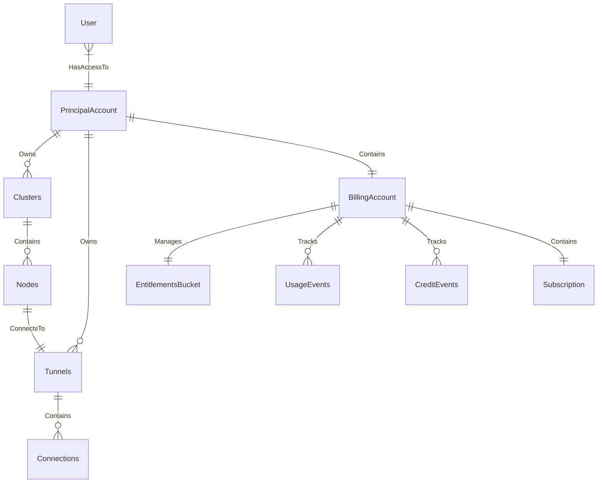

# Cloud API

## Data Model



| Info | Value |
| ---- | ----- |
| Language | Python |
| Framework | FastAPI |
| Storage | Postgres |

| Protocol | Purpose | Location |
| -------- | ------- | -------- |
| http | REST API, internal (behind nginx) | `http://cloud_api:8080/api/v2/cloud/` (`http://localhost:8080/...` outside Docker) |
| https | REST API, external (via nginx, Bearer token or mTLS) | `https://underleafapp.com/api/v2/cloud/` |

## Running locally

```bash
make run
```

Normally run as part of the cloud process group (`cd cloud && make run`, or `make run-cloud-api`) — see the [root README](../../README.md#development). Config is read from `configs/local/cloud_api.yaml` (or `UNDERLEAF_CONFIG` when containerized via [docker-compose.yaml](../../docker-compose.yaml)). Schema migrations live under `alembic/`.


## Testing Stripe end to end (sandbox)

Stripe can only reach a webhook it can see, so the repo ships a [Stripe CLI](https://docs.stripe.com/stripe-cli) listener as an opt-in compose service (`stripe_cli`, profile `stripe`). It forwards signed sandbox events to `cloud_api` over the compose network (not through nginx — the route authenticates by Stripe signature, not mTLS/bearer).

```bash
make stripe-up       # stack + listener; derives the matching whsec_ and hands it to cloud_api
make stripe-smoke    # trigger an event, assert it was verified, recorded and processed
make stripe-logs     # watch events and cloud_api's HTTP responses
make stripe-trigger EVENT=customer.subscription.updated
make stripe-down
```

- **Test mode only.** `scripts/stripe_env.sh` takes `UNDERLEAF_STRIPE_API_KEY` (or the test-mode key `stripe login` already stored) and refuses anything that isn't `sk_test_`/`rk_test_`.
- **Run it from the repo root**, after `docker compose build cloud_api` if you changed `cloud_api` code (`stripe-up` doesn't rebuild — Docker Desktop's default VM can run out of memory rebuilding `conn_worker` alongside it).
- `stripe trigger` creates *its own* sandbox customers and subscriptions, so it proves delivery, signature verification and idempotent recording, but not billing effects on a real account. For those, run `make stripe-sync`, then subscribe through the Plans page with test card `4242 4242 4242 4242` while the listener is up.
