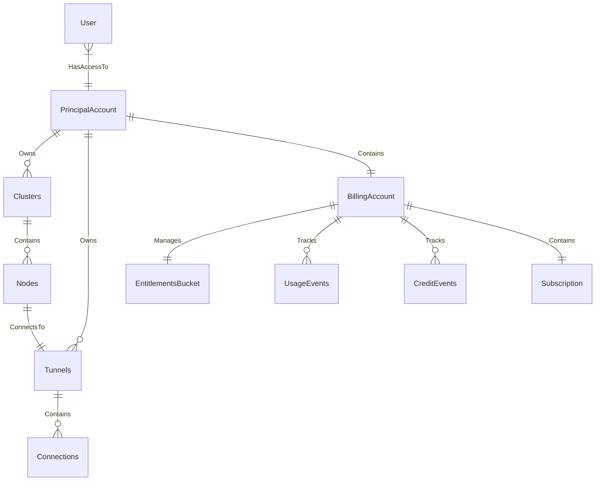

# Cloud API

## Data Model



| Info | Value |
| ---- | ----- |
| Language | Python |
| Framework | FastAPI |
| Storage | Postgres |

| Protocol | Purpose | Location |
| -------- | ------- | -------- |
| http | REST API, internal (behind nginx) | `http://cloud_api:8080/api/v2/cloud/` (`http://localhost:8080/...` outside Docker) |
| https | REST API, external (via nginx, Bearer token or mTLS) | `https://underleafapp.com/api/v2/cloud/` |

## Running locally

```bash
make run
```

Normally run as part of the cloud process group (`cd cloud && make run`, or `make run-cloud-api`) — see the [root README](../../README.md#development). Config is read from `configs/local/cloud_api.yaml` (or `UNDERLEAF_CONFIG` when containerized via [docker-compose.yaml](../../docker-compose.yaml)). Schema migrations live under `alembic/`.


## Assertion keys (RFD 5)

The cloud signs short-lived **assertions** (≈60 s, `aud` = cluster id, scopes, `exp`, `jti`) that a cluster's Orchestrator will verify before accepting a remote request. Design: [RFD 5, Remote access](../../RFDs/RFD-5.md#remote-access).

- **Dedicated key.** Ed25519 (JWS `EdDSA`), generated by [`lib/assertion_lib.py`](src/cloud_api/lib/assertion_lib.py) and stored apart from the root CA / OAuth JWT keypair (`assertion.keys_dir`: `<kid>.pem` 0600 + `<kid>.json` metadata). It shares no material with `private_key.pem`. In Docker it lives in its own `assertion_keys` volume, not under `./certs`, so nginx cannot read it. No key file is committed (`**/*.pem` is git-ignored).
- **Published key set.** `GET /api/v2/cloud/assertion-keys` (unauthenticated; public keys only) returns a JWKS with a `kid` and a `not_before`/`not_after` per key. Verifiers keep a key until its `not_after`.
- **Rotation.** The signer uses the newest key. A key older than `assertion.rotate_after_days` (90) is replaced automatically on next use; `python -m cloud_api.scripts.rotate_assertion_key` rotates on demand (`--compromised` expires the old keys at once). A replaced key stays published for `assertion.overlap_hours` (168): keep that longer than the verifiers' refresh interval plus the TTL.
- **Issuing.** `AssertionService.issue_for_cluster(account_id, cluster_id, scopes)` is the only intended entry point (it checks the account owns the cluster). There is deliberately no HTTP endpoint that mints one yet; attaching it to the tunnel is RFD 5 step 7b.
- **Verifier.** Go package [`shared/assertion`](../../shared/assertion) (wire format, strict key-set parsing, `Verify`). Both sides are tested against each other with the vectors in `shared/assertion/testdata/`.
- **Single process.** Keys are read from local disk; running several cloud_api replicas would need that directory on shared storage.

## Testing Stripe end to end (sandbox)

Stripe can only reach a webhook it can see, so the repo ships a [Stripe CLI](https://docs.stripe.com/stripe-cli) listener as an opt-in compose service (`stripe_cli`, profile `stripe`). It forwards signed sandbox events to `cloud_api` over the compose network (not through nginx — the route authenticates by Stripe signature, not mTLS/bearer).

```bash
make stripe-up       # stack + listener; derives the matching whsec_ and hands it to cloud_api
make stripe-smoke    # trigger an event, assert it was verified, recorded and processed
make stripe-logs     # watch events and cloud_api's HTTP responses
make stripe-trigger EVENT=customer.subscription.updated
make stripe-down
```

- **Test mode only.** `scripts/stripe_env.sh` takes `UNDERLEAF_STRIPE_API_KEY` (or the test-mode key `stripe login` already stored) and refuses anything that isn't `sk_test_`/`rk_test_`.
- **Run it from the repo root**, after `docker compose build cloud_api` if you changed `cloud_api` code (`stripe-up` doesn't rebuild — Docker Desktop's default VM can run out of memory rebuilding `conn_worker` alongside it).
- `stripe trigger` creates *its own* sandbox customers and subscriptions, so it proves delivery, signature verification and idempotent recording, but not billing effects on a real account. For those, run `make stripe-sync`, then subscribe through the Plans page with test card `4242 4242 4242 4242` while the listener is up.
