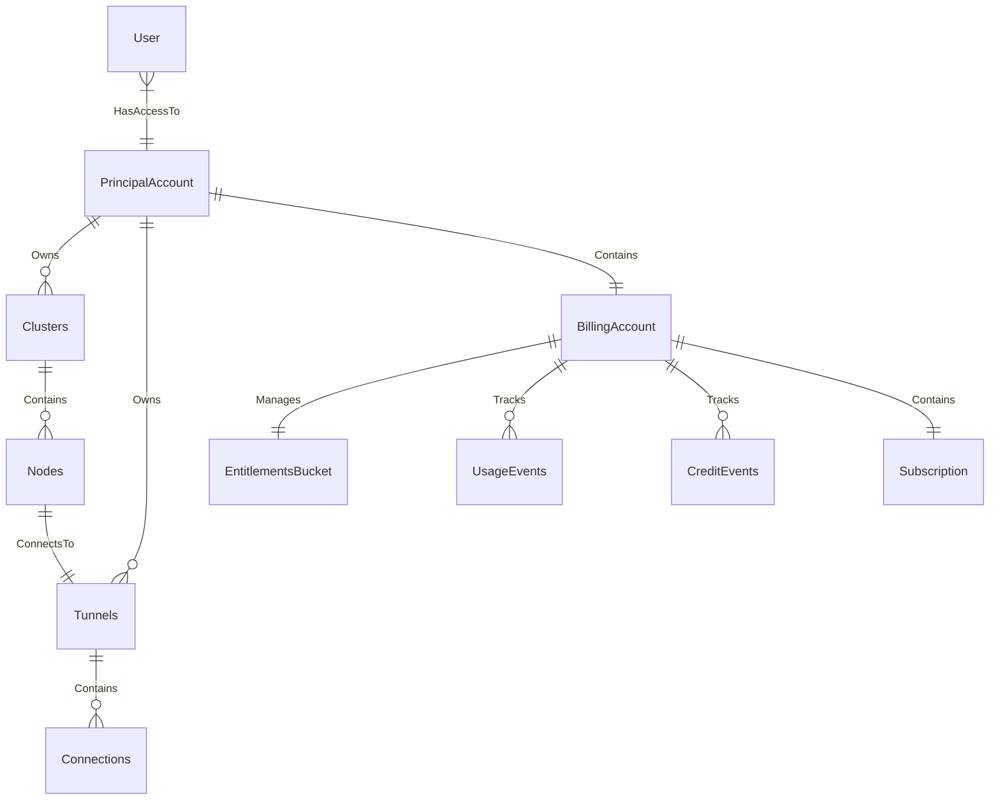

# Cloud API

## Data Model



| Info | Value |
| ---- | ----- |
| Language | Python |
| Framework | FastAPI |
| Storage | Postgres |

| Protocol | Purpose | Location |
| -------- | ------- | -------- |
| http | REST API, internal (behind nginx) | `http://cloud_api:8080/api/v2/cloud/` (`http://localhost:8080/...` outside Docker) |
| https | REST API, external (via nginx, Bearer token or mTLS) | `https://underleafapp.com/api/v2/cloud/` |

## Running locally

```bash
make run
```

Normally run as part of the cloud process group (`cd cloud && make run`, or `make run-cloud-api`) — see the [root README](../../README.md#development). Config is read from `configs/local/cloud_api.yaml` (or `UNDERLEAF_CONFIG` when containerized via [docker-compose.yaml](../../docker-compose.yaml)). Schema migrations live under `alembic/`.


## Keys and certificates (RFD 5)

Three unrelated private keys, each readable only by cloud_api:

| Key | File (config) | Signs | Notes |
| --- | --- | --- | --- |
| Cluster CA | `private_key.pem` (`oauth.private_key_path`) with `root_ca_cert.pem` | device/cluster client certificates, and nginx's server certificate | Never mounted into nginx. Existing registered clusters pin this CA, so it is **not** regenerated by an upgrade. |
| OAuth JWT | `jwt_private_key.pem` (`oauth.jwt_private_key_path`) | access and refresh tokens (RS256) | Generated on first start. Refused at startup if it is the same key as the CA key. |
| Assertion | `assertion.keys_dir` | cluster assertions (Ed25519) | See below. |

**Upgrading from the shared CA/JWT key.** The first start after the split generates `jwt_private_key.pem` (a warning is logged). Every token signed by the old shared key stops verifying, so **every user signs in once more**; nothing else changes (clusters keep their certificates, the assertion key is untouched). Do this at a time you are happy to sign everyone out.

**Server certificate.** nginx no longer presents the CA certificate with the CA key. At startup cloud_api issues a normal server certificate from the CA (ECDSA P-256, `serverAuth` only, not a CA, `tls.validity_days` = 365, reissued when it is within `tls.renew_before_days` of expiry, when `tls.server_names` / `tls.server_ips` change, or when the CA changes) and writes exactly three files to `tls.dir` (`./certs/tls` on the host): `root_ca_cert.pem` (public), `server_cert.pem`, `server_key.pem`. That directory is the only thing nginx mounts. Set `tls.server_names` to the names clusters dial; a cluster verifies the host it dials against them. nginx has to be reloaded to pick up a reissued certificate (`docker compose exec nginx nginx -s reload`).

**Pinned listener for the assertion key set.** nginx serves `GET /api/v2/cloud/assertion-keys` (and nothing else) on a dedicated port, `8443`, which always presents the CA-issued server certificate and never asks for a client certificate. Orchestrators fetch the key set there, trusting only the CA chain pinned at registration and checking the host name: set `assertion_keys_base_url` in the Orchestrator's config to `https://<cloud host>:8443/api/v2/cloud`. It is a separate port so that switching `:443` to a publicly trusted certificate for browsers later does not break the pinned fetch.

## Assertion keys (RFD 5)

The cloud signs short-lived **assertions** (≈60 s, `aud` = cluster id, scopes, `exp`, `jti`) that a cluster's Orchestrator will verify before accepting a remote request. Design: [RFD 5, Remote access](../../RFDs/RFD-5.md#remote-access).

- **Dedicated key.** Ed25519 (JWS `EdDSA`), generated by [`lib/assertion_lib.py`](src/cloud_api/lib/assertion_lib.py) and stored apart from the cluster CA key and the OAuth JWT key (`assertion.keys_dir`: `<kid>.pem` 0600 + `<kid>.json` metadata). It shares no material with either. In Docker it lives in its own `assertion_keys` volume, not under `./certs`, so nginx cannot read it. No key file is committed (`**/*.pem` is git-ignored).
- **Published key set.** `GET /api/v2/cloud/assertion-keys` (unauthenticated; public keys only) returns a JWKS with a `kid` and a `not_before`/`not_after` per key. Verifiers keep a key until its `not_after`.
- **Rotation.** The signer uses the newest key. A key older than `assertion.rotate_after_days` (90) is replaced automatically on next use; `python -m cloud_api.scripts.rotate_assertion_key` rotates on demand (`--compromised` expires the old keys at once). A replaced key stays published for `assertion.overlap_hours` (168): keep that longer than the verifiers' refresh interval plus the TTL.
- **Issuing.** `AssertionService.issue_for_cluster(account_id, cluster_id, scopes)` is the only way to mint one (it checks the account owns the cluster). Its one caller is [`GET /internal/remote-auth`](#remote-access-ufctl-and-cockpit-rfd-5-step-7b); there is no other minting route.
- **Verifier.** Go package [`shared/assertion`](../../shared/assertion) (wire format, strict key-set parsing, `Verify`). Both sides are tested against each other with the vectors in `shared/assertion/testdata/`.
- **Single process.** Keys are read from local disk; running several cloud_api replicas would need that directory on shared storage.

## Remote access: ufctl and Cockpit (RFD 5 step 7b)

The cloud half of [`ufctl connect`](../../RFDs/RFD-5.md#remote-access). Everything is under `/api/v2/cloud`.

### `ufctl login` (RFC 8628 device grant)

Wire contract: [`edge/cmd/ufctl/remoteaccess/doc.go`](../../edge/cmd/ufctl/remoteaccess/doc.go). Shaped like the cluster registration flow; pending requests live in Postgres (`device_login_requests`), 10 minutes, single use.

| Route | Auth | Purpose |
| --- | --- | --- |
| `POST /ufctl/device` `{device_name}` | none | `200 {device_code, user_code, verification_uri, verification_uri_complete, expires_in, interval}`. `verification_uri` is `<account_ui_base_url>/ufctl/activate`, the `user_code` is appended as `?user_code=`. |
| `POST /ufctl/token` `{grant_type, device_code}` | none | `200 {device_key_id, device_key}` once, or `400 {"error": "authorization_pending" \| "slow_down" \| "expired_token" \| "access_denied"}` (also `unsupported_grant_type`). The error is a **top-level** `error`, not the `{"detail": ...}` envelope the other routers use: that is what the Go client parses. Unknown, expired and already-used codes are all `expired_token`. Polling faster than `interval` (5 s) answers `slow_down` and raises the interval by 5 s (max 60). |
| `GET /ufctl/device/request?user_code=` | account access token | The pending request (device name, status) for the confirmation page. `404` unknown, `410` expired. |
| `POST /ufctl/device/approve` `{user_code}` | account access token | Binds the request to the caller's account (`azp`). `409` if already decided. |
| `POST /ufctl/device/deny` `{user_code}` | account access token | Denies it; `ufctl` gets `access_denied`. |
| `GET /ufctl/devices` | account access token | The caller's active device keys (id, name, created/last-used). Never the secret or its hash. |
| `DELETE /ufctl/devices/{id}` | account access token | Revokes a key. `204`; another account's id and a missing id are both `404`. |

The account UI page that approves a request is `/ufctl/activate` ([`UfctlActivate.tsx`](../account_ui/src/pages/UfctlActivate.tsx)). Failed `user_code` look-ups are limited to 10 per account per 10 minutes (`429`), and unauthenticated `POST /ufctl/device` to 120 per minute, both in process.

**Device keys** (`device_keys`): `ufdk_` plus 256 random bits (43 base64url characters), returned once by `/ufctl/token`, stored only as a SHA-256 hash, compared in constant time, revocable, never expiring on their own. `last_used_at` is updated at most every 5 minutes per key. A leaked key is a bearer credential for every cluster of its account until revoked.

### `GET /internal/remote-auth` (nginx `auth_request`)

nginx calls this for each request to `/clusters/{cluster_id}/remote/...` and, on `200`, copies the two response headers onto the request it forwards.

| In | |
| --- | --- |
| `Authorization: Bearer <credential>` | a device key (`ufdk_...`) **or** an account access JWT (Cockpit). A token minted from `X-Subject-Id` (its `sub` is a cluster or node), a refresh token (no `azp`) and an assertion are all refused. |
| `X-Underleaf-Cluster: <cluster_id>` | set by nginx from the URL. Exactly one value of `[A-Za-z0-9_.:-]`, at most 128 characters. |
| `X-Subject-Id` | **must be absent**. Any request carrying it is `400`, whatever else it has. |

| Out | |
| --- | --- |
| `200`, empty body | `X-Underleaf-Assertion: <jwt>` (about 60 s, `aud` = the cluster, `sub` = the account, scopes `read deploy admin`) and `X-Underleaf-Connection: <conn_id>`, the newest running connection named `remote-access` on a node of that cluster, or the empty string when there is none. |
| `400` | request carried `X-Subject-Id`. |
| `401` | no, malformed, unknown, revoked or expired credential. |
| `403` | the cluster does not exist, is malformed, or belongs to another account: one identical answer, so cluster ids cannot be probed. Authentication is judged first. |
| anything else | `5xx`; nginx must treat it as a failure (fail closed). |

All responses have an empty body, nothing the client supplied (including a client `X-Underleaf-Assertion`) is echoed, and credentials and assertions are never logged. `x_subject_id_token_middleware_` skips `/internal/` paths altogether.

**What nginx has to do** (not in this repo's nginx config yet): serve `/internal/` to nobody outside the compose network (`location ^~ /api/v2/cloud/internal/ { return 404; }` on the public server, and `internal;` for the auth location); in the auth subrequest set `X-Underleaf-Cluster` from the URL, pass `Authorization`, and set `X-Subject-Id ""`, `X-Underleaf-Assertion ""` and `X-Underleaf-Connection ""`; on the forwarded request overwrite `X-Underleaf-Assertion` from `auth_request_set $upstream_http_x_underleaf_assertion`, so a client-supplied one never gets through. The auth decision does not depend on any of this for its correctness: it refuses `X-Subject-Id` and ignores client-supplied assertion headers by itself.

## Testing Stripe end to end (sandbox)

Stripe can only reach a webhook it can see, so the repo ships a [Stripe CLI](https://docs.stripe.com/stripe-cli) listener as an opt-in compose service (`stripe_cli`, profile `stripe`). It forwards signed sandbox events to `cloud_api` over the compose network (not through nginx — the route authenticates by Stripe signature, not mTLS/bearer).

```bash
make stripe-up       # stack + listener; derives the matching whsec_ and hands it to cloud_api
make stripe-smoke    # trigger an event, assert it was verified, recorded and processed
make stripe-logs     # watch events and cloud_api's HTTP responses
make stripe-trigger EVENT=customer.subscription.updated
make stripe-down
```

- **Test mode only.** `scripts/stripe_env.sh` takes `UNDERLEAF_STRIPE_API_KEY` (or the test-mode key `stripe login` already stored) and refuses anything that isn't `sk_test_`/`rk_test_`.
- **Run it from the repo root**, after `docker compose build cloud_api` if you changed `cloud_api` code (`stripe-up` doesn't rebuild — Docker Desktop's default VM can run out of memory rebuilding `conn_worker` alongside it).
- `stripe trigger` creates *its own* sandbox customers and subscriptions, so it proves delivery, signature verification and idempotent recording, but not billing effects on a real account. For those, run `make stripe-sync`, then subscribe through the Plans page with test card `4242 4242 4242 4242` while the listener is up.
