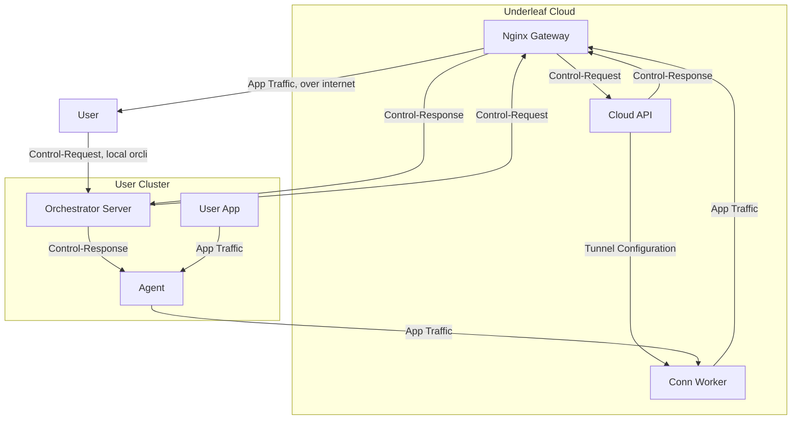
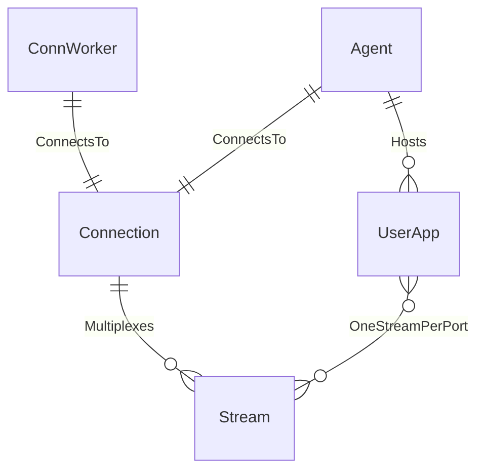

# Conn Worker

## Architecture



## API

### gRPC

This is the real integration surface: Cloud API talks to Conn Worker directly over gRPC (see `cloud_api/lib/conn_worker_client`) to create/list/inspect/close tunnels — there is no separate REST management API in front of it, and none is planned. Cloud API exposes its own REST CRUD for connections/streams to its own clients (`interface/connections/`, `interface/streams/` in `cloud_api`); Conn Worker itself only serves `/health` over HTTP (see the table below) and is not expected to grow a REST surface of its own.

Also used by the agent to establish and manage its connection with the Conn Worker (yamux-multiplexed) — see `interface/grpc/*.proto` and [connection_manager.go](service/connection_manager.go). Actual service:

```proto
service ConnectionWorker {
    // Connections
    rpc CreateConnection(CreateConnectionRequest) returns (Connection);
    rpc GetConnection(GetConnectionRequest) returns (Connection);
    rpc TerminateConnection(TerminateConnectionRequest) returns (google.protobuf.Empty);
    rpc ListConnections(google.protobuf.Empty) returns (stream Connection);

    // Streams
    rpc NewStream(NewStreamRequest) returns (Stream);
    rpc CloseStream(CloseStreamRequest) returns (CloseStreamResponse);
    rpc ListStreams(google.protobuf.Empty) returns (stream Stream);
    rpc GetStream(GetStreamRequest) returns (Stream);
}
```

## Data Model



| Info | Value |
| ---- | ----- |
| Language | Golang |
| Storage | Redis |

| Protocol | Purpose | Location |
| -------- | ------- | -------- |
| gRPC | Agent connection/tunnel management | `:50102` |
| http | internal health check only, no management REST API (Cloud API talks gRPC — see above) | `http://conn_worker:9070/api/v2/connections/health` |
| http(s) | Northbound: gateway client access, per-stream subdomain (via nginx) | `https://<stream-id>.gw.underleafapp.com` → `conn_worker:9020` |
| tcp+mTLS | Southbound: node/agent tunnel establishment (via nginx stream proxy) | nginx `:19021` → `conn_worker:9021` |
| http (plain, **internal only**) | Remote-access relay: nginx → cluster tunnel (see [Remote access relay](#remote-access-relay)) | nginx → `conn_worker:9071` (`remote_relay_port`) |

## Tunnel establishment

The agent (`edge/agent/lib/conn_client`) dials `nginx:19021` with mTLS; nginx's `stream` block terminates TLS and passes the plaintext through to `conn_worker:9021`. The agent then speaks, on that one raw connection:

1. `<connection_id>\n` (e.g. `conn_d1a2...`), then
2. yamux frames (the agent is the yamux client, the conn_worker the server).

`ConnectionManager.handleNewConnection` reads that first line (bounded, 10 s deadline, `conn_` + `[A-Za-z0-9_-]` only), looks the connection up in Redis, and starts a yamux session on the same connection, handing it any bytes that arrived behind the handshake line. A connection record in state `provisioned` (first dial) or `running` (redial) may connect; `closed` may not. The older form, an HTTP request whose `Host` is `<id>.connect.<domain>`, is still accepted but nothing in this repository sends it.

`LiveTunnels` maps connection id to the live session. The entry is removed when the session ends, so the agent can redial. A second dial for an id that already has a live session is refused; if the old session is closed or does not answer a yamux ping within 3 s (a half-open connection after a network drop), it is replaced.

## Remote access relay

Remote humans (Cockpit, `ufctl connect`) reach a cluster's Orchestrator through the cluster's standing tunnel (RFD 5, "Remote access"):

```
browser -> nginx --auth_request--> cloud_api   (authenticate, authorize, mint a fresh assertion)
              |
              +--> conn_worker relay :9071 --yamux stream--> agent --> Orchestrator remote listener
```

- **Listener:** plain HTTP on `connections.remote_relay_port` (yaml key `remote_relay_port` under `gateway:`, default `9071`). It is **internal only**: reachable by nginx on the compose network, never published (no `ports:` mapping in `docker-compose.yaml`, no public route). It does no authentication of its own, and anyone who can reach it can pick a tunnel and send it requests.
- **Request headers set by nginx** (and nothing else decides routing):
  - `X-Underleaf-Assertion`: a fresh cloud-signed assertion for this request. Passed through untouched.
  - `X-Underleaf-Connection`: id of the cluster's cloud connection. Removed before forwarding. Missing, empty, repeated, malformed, unknown, or not currently connected all get the same answer: `503 {"error":"cluster is not connected"}`, so the relay is not an oracle for which clusters exist.
  - The request path arrives already stripped of `/clusters/{id}/remote` and is forwarded byte for byte (path, escaping, query).
- **What is forwarded:** the end client's ordinary headers (`Cookie`, `Origin`, `Content-Type`, `Sec-WebSocket-*`, ...). Dropped: `Authorization`, `Proxy-Authorization`, `X-Subject-Id`, `Forwarded`, `X-Forwarded-*`, `X-Real-Ip`, and every `X-Underleaf-*` header except the assertion. `Host` becomes `127.0.0.1` (the remote listener does not enforce Host). The relay never adds, creates or checks an assertion.
- **Trust model:** the relay trusts nothing. It does not parse assertions or know who the caller is; the Orchestrator verifies signature, audience, expiry, `jti` and scope on every request and refuses any request without a valid assertion. The relay's job is routing and being a correct reverse proxy. The agent only accepts a cloud-opened stream that begins with `UNDERLEAF-REMOTE/1\n` (`assertion.StreamPreamble`) and splices it to the one configured Orchestrator remote listener.
- **Mechanics:** one yamux stream per request (`DisableKeepAlives`, so a request is never replayed on a reused connection and an assertion's single-use `jti` is not burned twice). The stream is opened with a 5 s timeout and the preamble is written first. Responses are flushed as produced (`FlushInterval: -1`; log/event streams work) and WebSocket upgrades are spliced both ways. Request and response bodies may overlap (full duplex).
- **Limits:** request headers at most 16 KiB (`431` above); 10 s to send headers; 30 s from request written to response headers (`504`; body and upgraded connections are not time-limited); at most 64 concurrent requests per connection (`429` above, the agent allows 128); no limit on request body size here, nginx's `client_max_body_size` governs. A tunnel dying under a request gives `502`; an agent that refuses the stream (remote access not configured there) gives `502`.
- **Errors:** `502 {"error":"cluster did not accept the request"}` (stream could not be opened), `502 {"error":"bad gateway"}` (upstream broke), `504 {"error":"cluster did not respond in time"}`.
- **`GET /health`:** answered by the relay itself only when the request carries neither `X-Underleaf-Connection` nor `X-Underleaf-Assertion` (a direct probe). Anything with those headers is relayed, including a `/health` that belongs to the Orchestrator.

## Running locally

```bash
make run
```

Normally run as part of the cloud process group (`cd cloud && make run`, or `make run-conn-worker`) — see the [root README](../../README.md#development). Config is read from `configs/local/conn_worker.yaml` (or `UNDERLEAF_CONFIG` when containerized via [docker-compose.yaml](../../docker-compose.yaml)); requires Redis.

